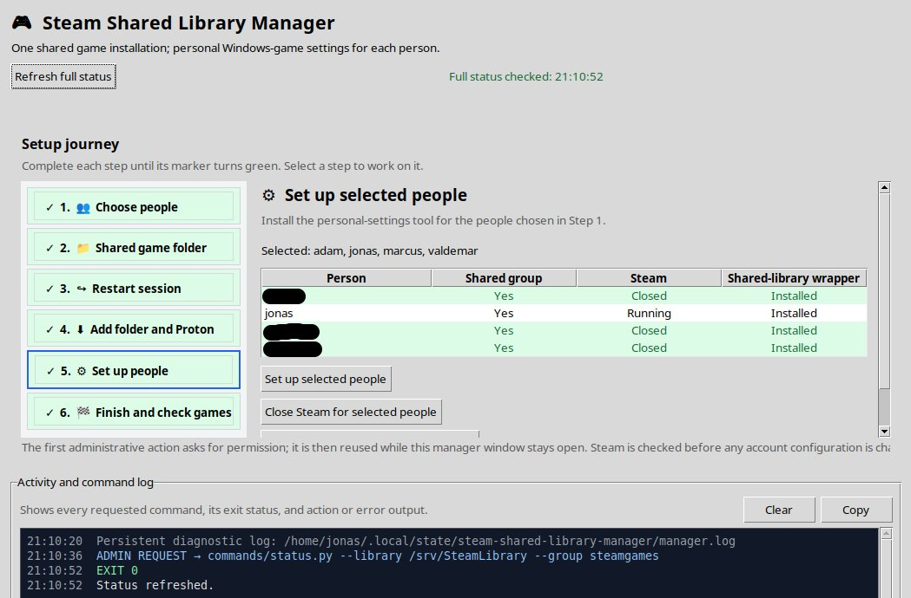

# Steam Shared Library Manager

**OBS: THIS IS 100% AI GENERATED. I ONLY TESTED IT. I DID NOT QA CODE**

Share one Steam game installation between several Linux accounts without
sharing settings, Proton state, or non-cloud saves. This makes Steam behave
similar to Windows for multiple users on the same computer.

Steam normally puts a non-Linux game's Proton prefix beside the shared game in
`steamapps/compatdata/<appid>`. This project installs a small compatibility
wrapper that instead uses:

```text
$XDG_DATA_HOME/steam-shared-library-proton/<appid>
```

Each Linux account therefore gets a private prefix while game assets remain shared. Official Proton and Steam Linux Runtime
are installed separately in each account’s local Steam library. Native Linux games are unaffected.
Steam displays the wrapper as **Shared library – personal settings (Proton)**.



## Supported setup

- Ubuntu or Debian with the native Steam client
- a local Linux filesystem with ownership, setgid, and ACL support
- Python 3 with Tkinter, `pkexec`, and the `acl` tools
- trusted household accounts that already have the necessary Steam licenses

Snap and Flatpak Steam are deliberately refused because their sandboxes use
different paths and cannot safely use the same system library. FAT/exFAT and
typical network shares are not suitable.

On Ubuntu, install the prerequisites and start Steam once:

```bash
sudo add-apt-repository multiverse
sudo dpkg --add-architecture i386
sudo apt update
sudo apt install acl pkexec python3-tk steam-installer
/usr/games/steam
```

## Quick start

Clone this repository from GitHub, then run:

```bash
git clone https://github.com/lindeloev/steam-shared-library-manager.git
cd steam-shared-library-manager
./launch-gui.sh
```

Alternatively, [download the source as a ZIP][source-zip] and extract it. If
executable permissions were lost in the download, use:

```bash
sh ./launch-gui.sh
```

The manager guides you through six steps:

1. Choose the Linux accounts that will share games.
2. Prepare a missing/empty folder, or inspect and repair an existing Steam
   library.
3. Check access. Direct user ACLs normally make a logout unnecessary.
4. Install an official Proton in each person’s local Steam library.
5. Close Steam, install the personal-settings wrapper, register the shared
   game folder, and keep each local library as the default for tools.
6. Restart Steam and check configuration and recorded game launches.

The manager selects each person's primary local library as Steam's remembered
install destination. Dependency placement also depends on Steam's own install
flow; this preference is not a guarantee that every automatic download stays
local. When installing a
game, choose the shared folder (for example `/srv/SteamLibrary`) in **Install To**.
Steam has a single install default, so this also means new games initially offer
local storage. Keep local storage as default even after installing a shared game.

Step 4 previews and copies misplaced Proton and runtime packages into every
selected account's local library. This also handles runtimes with no Steam move
menu and Hotfix destination conflicts. Identical packages are verified and kept;
different local copies are backed up before explicitly approved replacement.
Runtime `var/` caches are recreated by each user. Shared sources are retained in
quarantine only after all registered users' local copies verify.

Step 5 shows the proposed Proton version, runtime and private prefix location
for each person. It configures the wrapper selection automatically and preserves
per-game overrides. The administrator can configure other accounts without
adding their own account to the shared library. Every account must have signed
in to native Steam at least once; the manager does not handle Steam credentials.

Existing games already in shared storage are recognized and their permissions
can be repaired. Moving games from a person's private library remains a Steam
Storage operation; the manager does not silently reorganize private game installs.

Steam's remembered install destination can change. Actual tool locations are
checked separately; a local preference is not a placement guarantee. The
read-only `commands/audit-install-locations.py` records locations and compares
new downloads. See [MANUAL_TEST.md](MANUAL_TEST.md) for the acceptance procedure.

Navigation selections are saved in:

```text
~/.config/steam-shared-library-manager/state.json
```

Passwords, authorization, and cached status are never stored.

## What the manager is allowed to do

The GUI starts without administrator access. The first privileged action uses
the normal PolicyKit prompt, then keeps one narrowly scoped helper alive until
the window closes. At authorization time, that helper copies its fixed command
set into a root-private temporary directory, so later edits to the checkout
cannot change the code running in the authorized session. Its Python interpreter
also runs in isolated, no-bytecode mode. The manager will not close while an
operation is active.

The bottom **Activity and command log** shows every requested command with
shell-style argument quoting, its exit code, and its full output. A private
persistent copy is kept at:

```text
~/.local/state/steam-shared-library-manager/manager.log
```

All programs that inspect or change Steam, account, library, or prefix state
live in [`commands/`](commands/README.md). The privileged helper accepts a fixed
allow-list and passes arguments directly—never through a shell. Mutating
commands preflight paths and accounts, refuse symlinked library paths and
personal primary Steam folders, and use collision-resistant backups and
same-directory temporary files before atomically replacing Steam
configuration. Account files are written after permanently dropping to the target account.
The storage writer uses pinned directory handles and stops if a file changed
after preflight. GUI and command-line changes are serialized with the permissions
monitor; per-account locks prevent simultaneous setup writes.

Personal prefix directories are forced to mode `700` during installation and
whenever the wrapper starts. Shared game files are writable by the selected
access group, so group members must
be trusted: any member able to update shared games can also alter executables
another member may later run.

The wrapper tolerates Steam runtimes that omit AppID environment variables and
start outside the game directory by matching an absolute launch argument below
`steamapps/common/<installdir>` to `appmanifest_*.acf`.

## Automatic update permissions and recovery

Preparing or repairing a library installs a root-owned systemd service:
`steam-shared-library-manager.service`. It checks completed game manifest updates
every 30 seconds and restores group and named user ACL access to affected game
files. It excludes Proton and runtimes, refuses linked/special and root/service-owned
files, and never executes downloaded game code. The service also reconciles named
ACLs when group membership changes. Without systemd, manual repair remains available.
Existing group credentials can persist in already-running sessions after membership
removal, as with ordinary Unix groups.

The installed monitor code is under `/usr/local/lib/steam-shared-library-manager`;
its root-owned library configuration is under `/etc/steam-shared-library-manager`.
Monitor messages are available with:

```bash
journalctl -u steam-shared-library-manager.service
```

Wrapper and tool replacement is staged and verified. Recovery records and previous
wrapper/tool copies are stored under each primary Steam root in
`.steam-shared-library-manager/operations` and `backups`. Interrupted publications
are recovered on the next mutating command. Shared tool quarantine is under
`LIBRARY/.steam-shared-library-manager/quarantine`. Backups and quarantine are
retained; no automatic cleanup deletes them.

The wrapper generates a manifest from validated Proton fields. If an update changes
its runtime dependency, it refreshes that manifest and requires a Steam restart.
A retry under the same Steam process does not bypass that guard.

The GUI distinguishes configuration checks from recorded Proton launch success.
Native/mixed file layouts are reported as uncertain rather than used as proof of
Steam's launch mode. **Export diagnostics** writes a private JSON report of relevant
status, excluding raw Steam configuration, recovery originals and session environment.

## Command line

The same operations are available without the GUI. For example:

```bash
# Create a new library. PATH must be missing or empty.
sudo ./commands/setup-shared-library.sh \
  --library /srv/SteamLibrary --group steamgames user1 user2

# Install Proton locally for each user first, then configure shared games.
sudo ./commands/add-user.sh --close-steam \
  --default-library /srv/SteamLibrary --group steamgames \
  --base-proton '/home/user1/.local/share/Steam/steamapps/common/Proton - Experimental' \
  user1 user2

# Preview, then migrate explicit per-game Proton selections.
sudo ./commands/migrate-existing-games.sh --dry-run user1 user2
sudo ./commands/migrate-existing-games.sh --apply user1 user2
```

Run any script with `--help` and see
[`commands/README.md`](commands/README.md) for the complete command inventory.

## Update or remove

Close Steam and rerun setup or `install.sh` to update the wrapper or select a
different preferred local official Proton. Original selections are saved so
uninstall can restore them when they still refer to this manager.

To remove only this project's Steam registration:

```bash
sudo ./commands/uninstall.sh user1 user2
```

Existing per-user prefixes, shared games, library access and update monitoring
remain. Uninstall removes managed compatibility selections and restores recorded
previous choices without overwriting choices the person changed afterwards. Removing prefixes can erase
local saves and settings, so it requires an explicit flag:

```bash
sudo ./commands/uninstall.sh --remove-prefixes user1 user2
```

## Scope and testing

This helper does not bypass Steam Families, licensing, anti-cheat, or individual
game limitations. It only separates per-user Proton data from shared assets.

The current implementation has been usage-tested on two multi-user Ubuntu
26.04 systems. Development was AI-assisted; review and testing are ongoing.
Contributions and reports from other native Debian/Ubuntu configurations are
welcome through the [GitHub issue tracker][issues].

The current implementation has automated regression coverage; the new admin
setup, migration and monitor flow still needs the final manual test on this PC.
Run the standard-library regression tests with:

```bash
python3 -m unittest discover -s tests -v
```

GitHub Actions runs these tests plus Python compilation, POSIX shell syntax
checks, and ShellCheck on each push and pull request.

Licensed under the [MIT License](LICENSE).

[issues]: https://github.com/lindeloev/steam-shared-library-manager/issues
[source-zip]: https://github.com/lindeloev/steam-shared-library-manager/archive/refs/heads/main.zip
